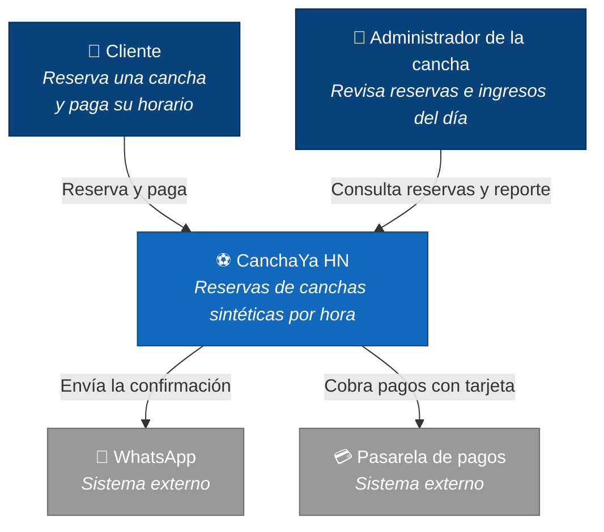
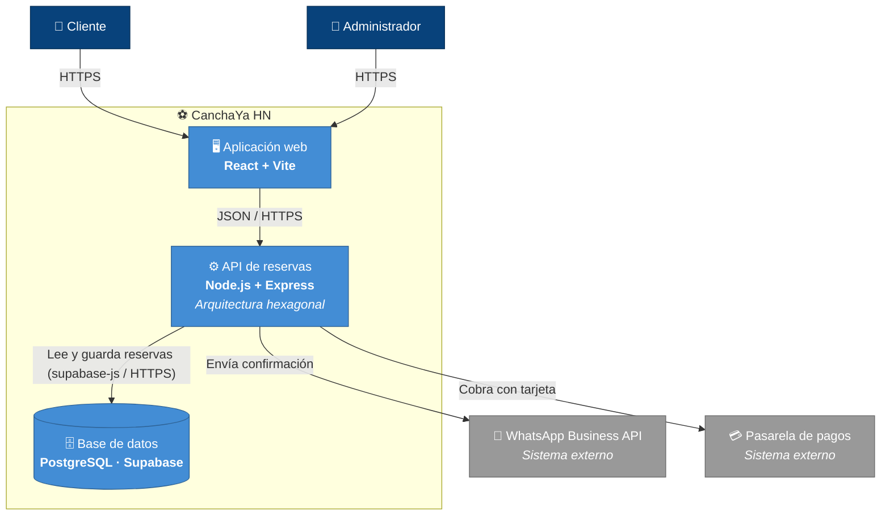

# Práctica 6 · Diagrama C4 de CanchaYa HN

**Sistema:** CanchaYa HN, reservas de canchas sintéticas de fútbol por hora.
**Autor:** Abraham Rivera
**Código:** [`canchas.js`](./canchas.js) implementa el núcleo de la API con arquitectura hexagonal, el patrón Repository y los patrones GoF del módulo. Para ejecutarlo: `node --test-reporter=spec canchas.js`

---

## Nivel 1 · Contexto

> ¿Quién usa el sistema y con qué sistemas externos habla? **Cero tecnologías.**

**Decisiones y atributos de calidad:**
1. **Confirmaciones por WhatsApp y no por correo.** Elegí **usabilidad** sobre **costo**: supongo que los clientes de una cancha coordinan sus partidos por WhatsApp y lo revisan más que el correo. A cambio, cada mensaje tiene costo y dependo de un proveedor externo.
2. **El cobro con tarjeta lo hace una pasarela externa.** Elegí **seguridad** sobre **costo**: el sistema nunca toca los datos de la tarjeta, a cambio de pagar una comisión por cada cobro.

---

## Nivel 2 · Contenedores

> Zoom dentro de CanchaYa HN: piezas desplegables y sus tecnologías.

> **Alcance del código:** la conexión con la pasarela de pagos está diseñada, pero no implementada en `canchas.js`. Ahí solo existe el cálculo del recargo por método de pago (patrón Strategy).

**Decisiones y atributos de calidad:**
1. **Una sola API (monolito) y no microservicios.** Elegí **simplicidad** y **mantenibilidad** sobre **escalabilidad**: para una cancha con pocos usuarios, un solo deploy es más fácil de operar. Si el sistema crece a muchas canchas, se puede separar después.
2. **Arquitectura hexagonal dentro de la API.** Elegí **mantenibilidad** y **testeabilidad** sobre **simplicidad**: las reglas de reserva no conocen la base de datos, así que puedo probarlas sin Supabase y cambiar de base de datos sin tocar el negocio. A cambio, hay más piezas que entender.

---

## Correcciones a la IA

Generé el borrador con IA y al revisarlo corregí lo siguiente:

1. **Flecha API → Base de datos.** El borrador decía "Lee y guarda reservas (SQL)". Con Supabase, la API no manda SQL directo: usa la librería `supabase-js`, que se comunica por HTTPS. Lo cambié a "supabase-js / HTTPS".
2. **Pasarela de pagos presentada como si ya existiera.** El nivel 2 dibuja la conexión con la pasarela, pero en `canchas.js` no hay ninguna integración de pagos, solo el cálculo del recargo. Agregué una nota de alcance debajo del diagrama para que el diagrama no prometa algo que el código no hace.
3. **Afirmación sin fuente.** La justificación del nivel 1 decía que "en Honduras casi nadie revisa el correo". No tengo un dato que lo respalde, así que lo reescribí como un supuesto de diseño y no como un hecho.
